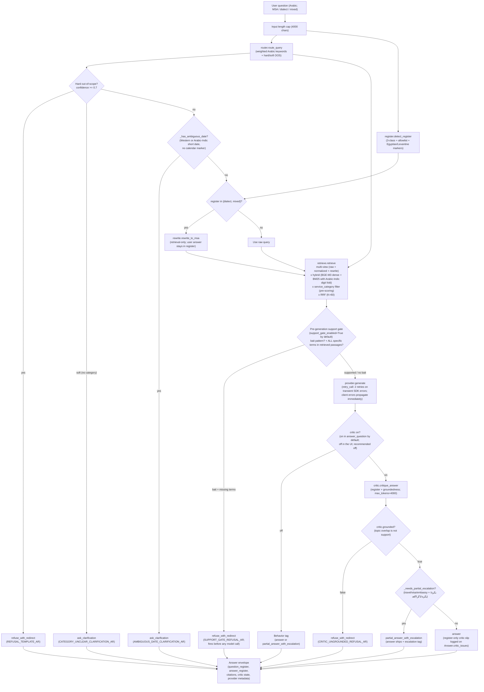

# Murshid — Architecture

Arabic-first retrieval-augmented answering over a synthetic corpus of Saudi government-services
FAQs: 20 source documents (84 chunks) in 5 service categories, 16 questions, 11 gold answers and
10 red-team cases that the rules were tuned on, and a held-out split of 68 questions, 25 red-team
cases and 31 gold answers that they were not (`data/heldout/`). The bench (`bench/results.md`)
records what each provider did on the tuned items.

Voice throughout: when a statement rests on an external source, the source is named or the
limitation flagged; when it rests on a bench number, the file is named.

---

## 1. What Murshid is — the product contract

Murshid is intentionally narrower than a generic chatbot. The contract:

- **Answer in the user's register** — MSA, dialect or mixed, matched to the question.
- **Cite retrieved source passages** by `{source_id, service_title, chunk_id, passage_text}`.
- **Preserve quoted source text verbatim in MSA**, even when the explanation around it is in
  dialect (red-team case rt-010 tests this).
- **Ask for clarification** when the question is ambiguous: a short numeric date with no calendar
  marker, or no service category matched.
- **Refuse, or answer in part and escalate**, when the answer is outside the corpus: a hard
  out-of-scope trigger (`قرض`, `ألم صدر`, ...), a policy-bait question whose specific terms no
  retrieved passage contains (the support gate), or a question that mixes an in-corpus part with
  travel, visa or embassy matters. With the optional critic switched on, a critic verdict of
  "ungrounded" also refuses.

These four behaviors (`answer`, `partial_answer_with_escalation`, `refuse_with_redirect`,
`ask_clarification`) are decided by rules before the model is called, except the critic's
refusal, which comes after. The scope is small on purpose: 20 documents, rules that can be read,
and a bench that records every decision. The depth is in the places where the system refuses to
blur Arabic-specific distinctions — dialect vs MSA, source quote vs paraphrase, ambiguous date vs
guessed date, national ID vs residency permit, grounded answer vs plausible policy invention.

---

## 2. System diagram

```
            ┌──────────────────────────────────────────────┐
            │  User query (Arabic; MSA / dialect / mixed)  │
            └──────────────────────────┬───────────────────┘
                                       │
                                       ▼
                       ┌───────────────────────────┐
                       │  pipeline.answer_question │
                       └───────────────────────────┘
                                       │
        ┌──────────────────────────────┼──────────────────────────────┐
        │                              │                              │
        ▼                              ▼                              ▼
┌─────────────────┐         ┌─────────────────┐           ┌─────────────────────┐
│ router.py       │         │ register.py     │           │ length cap          │
│ Arabic keywords │         │ 3-class detect  │           │ (4000-char input)   │
│ + weighted      │         │ + allowlist     │           └─────────────────────┘
│ scoring + hard/ │         │ + Egyptian /    │
│ soft OOS        │         │ Levantine fam.  │
└────────┬────────┘         └────────┬────────┘
         │                           │
         │   ┌───────────────────────┘
         │   │
         ▼   ▼
┌───────────────────────────────┐
│  Behavior short-circuits      │
│  (hard OOS / soft OOS /       │      ┌─────────────────────────────┐
│   ambiguous date)             │─────▶│ refuse_with_redirect OR     │
└────────────┬──────────────────┘      │ ask_clarification (templated)│
             │ (in-corpus path)         └─────────────────────────────┘
             ▼
┌─────────────────────────────────────────────────────────┐
│  rewrite.py  (dialect → MSA, only when register≠MSA)    │
└────────────┬────────────────────────────────────────────┘
             ▼
┌─────────────────────────────────────────────────────────┐
│  retrieve.py                                            │
│  Multi-view:   raw + light-normalized + MSA-rewrite     │
│  Hybrid:       BM25 sparse + BGE-M3 dense               │
│  BM25 norm:    light_normalize + Arabic-Indic digit fold│
│  Fusion:       RRF (K=60, Cormack 2009)                 │
│  Filter:       service_category from router (pre-scoring)│
└────────────┬────────────────────────────────────────────┘
             ▼
┌─────────────────────────────────────────────────────────┐
│  Pre-generation support gate (when support_gate_enabled)│
│  Bait patterns: hearsay / auto-action / special-exempt  │
│  Term-match:   ALL specific terms must appear in any    │      ┌─────────────────────────────┐
│                retrieved passage                        │─────▶│ refuse_with_redirect        │
│  Refuse if:    bait detected + term(s) missing          │      │ (SUPPORT_GATE_REFUSAL_AR;   │
│  Decided before the model is called                     │      │  fires before model call)   │
└────────────┬────────────────────────────────────────────┘      └─────────────────────────────┘
             ▼  (supported → proceed)
┌─────────────────────────────────────────────────────────┐
│  provider.generate(SYSTEM_PROMPT_AR, user)              │
│  retry_call wraps SDK on transient errors only          │
└────────────┬────────────────────────────────────────────┘
             ▼
┌──────────────────────────────────────┐
│  critic.py  (only when critic is on; │
│  on in answer_question, off in UI)   │      ┌──────────────────────────┐
│  register + groundedness verdict:    │─────▶│ refuse_with_redirect     │
│    grounded=false        → refuse    │      │ (when grounded=false)    │
│    register-only mismatch→ log+ship  │      └──────────────────────────┘
└────────────┬─────────────────────────┘
             │
             ▼  (when grounded OR critic off)
┌─────────────────────────────────────────────────────────┐
│  partial-escalation tag                                 │
│    travel/visa/embassy terms + بكرة/بكره/باكر/الغد in   │
│    in-corpus query → behavior=partial_answer_with_      │
│    escalation (answer ships, escalation flagged)        │
└────────────┬────────────────────────────────────────────┘
             ▼
┌─────────────────────────────────────────────────────────┐
│  Answer envelope                                        │
│    answer_text + citations (verbatim MSA quotes) +      │
│    question_register + answer_register +                │
│    routing + critic state + provider metadata           │
└─────────────────────────────────────────────────────────┘
```

The 4-state behavior vocabulary is enforced end-to-end. Every Answer carries the behavior tag,
the routing decision, both register fields (question vs answer), the critic verdict, and provider
metadata. The bench reads this envelope verbatim.

### Mermaid version (for renderers that support it)



The two diagrams encode the same control flow; the Mermaid version renders in GitHub, VS Code
preview and most Markdown viewers. The ASCII version is the fallback for terminal-only reading
and is the authoritative one.

---

## 3. Component contracts

| Module | Contract | Notes |
| --- | --- | --- |
| `normalize.py` | `light_normalize(text)`, `fold_arabic_indic_digits(text)`, `to_arabic_indic_digits(text)`, `aggressive_normalize(text)`, `normalize(text, *, aggressive=False)` | `light_normalize`: NFKC + tatweel strip + diacritic strip + hamzated-alef → bare-alef. Stdlib only. Does NOT collapse ى, ة or hamza variants (ADR 3). `fold_arabic_indic_digits` (and its inverse) folds `٠١٢٣ ↔ 0123` at the retrieval layer, wired into `retrieve._bm25_normalize`; it is not part of `light_normalize`. The lossy set is opt-in by argument; no environment variable switches it. |
| `hijri.py` | `extract_hijri_dates(text) -> list[HijriDate]`, `has_hijri_date(text) -> bool`, `canonicalize_month_name(variant) -> str` | Detects DAY + MONTH (+ optional YEAR + optional `هـ` marker) across the 12 Hijri months, including spelling variants (`ربيع الأول` / `ربيع الاول`, `ذو القعدة` / `ذي القعدة`, `ربيع الثاني` ↔ `ربيع الآخر`). Stdlib regex only. **Standalone: nothing in the pipeline calls it.** The pipeline's ambiguous-date check uses its own simpler `هـ`-marker test. Calendar arithmetic is out of scope (it would need `hijri-converter` or `umalqurra`). |
| `ingest.py` | `build_index(data_dir, enrichment_provider) -> Index` | Deterministic chunker: FAQ sources split on `س:` markers, prose splits on blank lines (84 chunks from the 20 sources). A per-chunk model call writes a `summary` + `keywords`, concatenated into the BM25 and embedding input only — `passage_text` stays verbatim. The bench, demo and UI use `METADATA_ENRICHMENT_PROVIDER` (mock by default). `Chunk.enrichment_status` records `ok | failed_provider | failed_json | skipped`. |
| `retrieve.py` | `retrieve(query, index, *, rewritten_query, service_category, top_k, bm25_index) -> list[RetrievalResult]` | Multi-view (raw + light-normalized + MSA rewrite) × hybrid (BM25 + BGE-M3 dense) fused via RRF (K=60), top 5. Service-category filter applied **before** scoring. Identical views are deduplicated. The BM25 layer folds Arabic-Indic digits; the dense layer uses the unfolded text. |
| `register.py` | `detect_register(text: str) -> RegisterResult` | 3-class: MSA / dialect / mixed. A 14-token domain allowlist (`iqama`, `OTP`, `IBAN`, `Absher`, …) does not flip a question to `mixed`. MSA-formal markers + dialect markers → `mixed`. Egyptian (`إزاي / مش / اللي`) and Levantine (`هيك / ليش / كيفك`) markers are detected as `dialect`, with a coarse `dialect_family` hint. `contains_code_switching` is a separate boolean. |
| `router.py` | `route_query(query: str) -> RoutingResult` | Rules-first Arabic-keyword classifier into `{iqama, traffic_fines, sponsorship_transfer, municipal_permits, labor_office, out_of_scope}`. Multi-word keywords (e.g. `تصريح العمل`) outweigh single words (`تصريح`). Confidence: 0.9 for a hard out-of-scope trigger (→ refuse), 0.5 when no category matches (→ clarify), otherwise 0.95 / 0.85 / 0.75 / 0.6 by score and margin. A `MEDICAL_PATTERNS` regex separates `صدر` the verb ("was issued") from `صدر` the noun ("chest"). Synonyms: `غرامة / مخالفة`, `بطاقة الإقامة / كرت الإقامة / إقامة`, `إذن العمل / تصريح العمل / رخصة عمل`. |
| `rewrite.py` | `rewrite_to_msa(query, provider) -> str` | Model-backed dialect → MSA query rewrite via the `[ROLE: rewrite]` sentinel, used only for retrieval; the answer stays in the user's register. The zero-key providers return the query unchanged. |
| `prompts.py` | `SYSTEM_PROMPT_AR` + `SYSTEM_PROMPT_SHORT_AR` | The answer rules: answer in the user's register; quote sources verbatim in MSA, in quotation marks; invent no policy, fee, date or procedure; answer only what was asked; answer the in-corpus part and send the rest to the competent authority; refuse politely when the sources fall short. Two few-shot examples show register matching. |
| `critic.py` | `critique_answer(query, answer, citations, provider) -> CriticResult` | An optional second model call (`[ROLE: critic]`) that returns a register and groundedness verdict as JSON. Fails closed: if the call errors or its JSON cannot be parsed, `valid=False` and `grounded=False`, which refuses. `max_tokens=4000` (thinking models spend output budget before the JSON). `answer_question` runs it unless called with `critic_enabled=False`, and `scripts/demo.py` keeps that default; the UI's checkbox starts off. ADR 2 recommends off and records what it did in the recorded run. |
| `pipeline.py` | `answer_question(query, index, provider, *, bm25_index, top_k, critic_enabled, support_gate_enabled) -> Answer` | Router → register → short-circuits → rewrite → retrieve → **support gate** → generate → critic (if on) → partial-escalation tag. Input capped at 4000 characters. The support gate fires after retrieval and before generation when the question matches a policy-bait pattern (hearsay `سمعت أن` / `قيل لي` / `قالوا لي`, an automatic effect such as `تنحذف ... تلقائياً`, a special exemption `إعفاء خاص` / `استثناء خاص`) AND one or more of the question's specific claim terms (numbers, demographic markers, auto-action verbs) appear in no retrieved passage. `support_gate_enabled=False` turns it off for ablation. `Answer.question_register` is detected on the query, `Answer.answer_register` on the generated text. `_has_ambiguous_date` covers Western (`10/09`) and Arabic-Indic (`١٠/٠٩`) short dates. |
| `settings.py` | `get_settings() -> Settings` | One typed settings object (on the vendored C02 core) read from the environment and `.env`; a bad value stops the program with the variable's name, never its value. `.env.example` lists exactly these settings. |
| `providers/factory.py` | `build_provider(kind, model_id=None, settings=None)`, `available_kinds(settings)` | The one registry: six provider kinds, default model ids (the judges' too), the models the UI offers, and the dated price tables. A paid kind is available only when its key is set and its SDK installed. |
| `providers/base.py` | `LLMProvider` protocol + `ProviderResponse` + `retry_call` | Providers expose `name`, `model_id`, `generate(system, user, max_tokens, timeout)`, `is_available()`, `cost_estimate_usd(response)`. `retry_call` is the only retry layer (the SDKs' own retries are off): 2 retries with backoff on transient errors (5xx, 408, 429, network timeouts); client errors propagate at once. `finish_reason` is the vendor's real reason, normalised to `stop / length / content_filter / tool / other`. |
| `providers/extractive.py` | `ExtractiveProvider` (kind `extractive`, the default) | Zero-key, no network, deterministic: the answer is the top retrieved passage, and the second when it adds something, quoted verbatim inside one fixed MSA frame. |
| `providers/replay.py` | `ReplayProvider` (kind `replay`) | Zero-key: answers a bench question with the recorded Claude or OpenAI answer from `bench/case-cache.json` (OpenAI, critic off, by default); any other question falls back to the extractive answer. `raw` says which. |
| `providers/mock.py` | `MockProvider` (kind `mock`) | A test double: a fixed placeholder answer, identity rewrite, a passing critic. |
| `providers/claude.py`, `openai.py`, `gemini.py` | Paid providers | Claude via `anthropic` (default `claude-sonnet-4-6`); OpenAI via `openai` (default `gpt-5.5-2026-04-23`, sent `max_completion_tokens`, which GPT-5.x requires); Gemini via `google-genai` (default `gemini-3.1-pro-preview`; Gemini 2.5 thinking capped at half the output budget). One SDK client per provider, built on first use; no SDK is imported until a call is made. |
| `bench/metrics.py` | `evaluate_case`, `evaluate_red_team_case`, `aggregate`, `dump_cases` / `load_cases` | Per case: recall@5 (gold `quoted_passage` found in the retrieved passages), correctness + register (judge JSON with matched, missing and irrelevant facts and 0-3 scores), faithfulness (a second judge call), citation accuracy (gold passages quoted verbatim in the answer), behavior match, cost, latency. Refusal tone (0-3) for non-answer behaviors; for red-team cases a rubric judge reads the case's `evaluation_notes` and its pass requires a behavior match. Recall and citation accuracy skip cases expected to short-circuit. Critic-gated refusals are counted by cause. |
| `bench/runner.py` | `python -m murshid.bench [flags]` | `--split {tuned,heldout}` (one split per run, each in its own folder: `bench/` or `bench/heldout/`, or `--out-dir`), `--providers`, `--critic`, `--mode {full,red_team,standard}`, `--question-ids` / `--red-team-ids`, `--no-sanity-swap`, `--overwrite`, `--render-only` (re-render from the folder's case cache and manifest with no model call), `--max-cost-usd` (a cap on logged spend: no paid call starts once it could pass the cap, and a case it cuts short is left out). Writes `results.md`, `case-cache.json`, `cost-log.jsonl`, `refusal-log.jsonl`, `run-manifest.json` (split, commit and dirty flag as the run started, model ids, dates, data-file hashes, spend and the prices used) and, when a paid model is called, `spend-log.jsonl`. Refuses a folder holding a run of the other split, and replaces a recorded run only with `--overwrite`. The results page leaves the mock provider out of its tables. The sanity swap re-scores the same predicted answer with a second judge. |

---

## 4. ADR 1 — Embedding choice: BGE-M3

**Decision:** BGE-M3 (MIT license, 1024-dim, 8192-token context, loaded with
`sentence-transformers`).

**Evidence (Arabic-specific benchmarks):**

- **Alsubhi 2025** ("Optimizing RAG Pipelines for Arabic", arXiv 2506.06339) reports BGE-M3 mean
  RAGAS 70.99 across six Arabic datasets, beating multilingual-e5-large at 70.31. *Verification
  flag: cited from secondary research notes; the table was not re-extracted from the paper for
  this project. If the numbers prove subtly different, the directional choice (BGE-M3 over
  multilingual-e5-large for Arabic) is the load-bearing claim and likely survives.*
- **MIRACL Arabic** main_score 0.789 for BGE-M3 vs 0.691 for OpenAI text-embedding-3-large.
  *Same verification flag.*
- **License confirmed against the Hugging Face model card** on 2026-05-22 — MIT, not Apache-2.0
  (earlier notes had this wrong).

**Tokenizer alignment with normalization** (ADR 3 has the full rationale): BGE-M3's tokenizer was
trained on minimally normalized text. Aggressive normalization (collapsing ى → ي, ة → ه, hamza
folding) erases meaningful distinctions in MSA proper nouns and government and legal Arabic, and
mis-aligns inputs with the tokenizer's training distribution. The default is light
normalization; the lossy set exists but is opt-in.

**Swan-Small was considered and not tried.** Swan-Small (164M, 768-dim, ArabicMTEB 57.33) was the
smaller alternative. BGE-M3 already put both gold targets of q-001 and q-007 at retrieval ranks 1
and 2, so there was little for a smaller embedder to win on this corpus.

**Tools:** stdlib `unicodedata` + regex, not CAMeL Tools. CAMeL Tools' default normalization is
aggressive (it collapses the letters ADR 3 keeps distinct); using it correctly means opting out
of its defaults. The four operations needed are about 30 lines of stdlib + regex, which avoids a
~150 MB data-download dependency. CAMeL Tools remains the right choice for richer Arabic NLP
(lemmatization, POS, dialect ID).

---

## 5. ADR 2 — LLM provider strategy

**Decision:** one provider registry (`providers/factory.py`) with six kinds — three zero-key
(`extractive`, the default; `replay`; `mock`) and three paid (`claude`, `openai`, `gemini`) — and
model ids set per vendor through the settings. The recorded bench ran three of them: mock,
Claude and OpenAI. Gemini served only as the judge: a focused run that tried
`gemini-3.1-pro-preview` as a provider (`bench/archive/results-gemini-pro-focused.md`) got a
quota error (HTTP 429) on every cell that needed a model call, so it produced no answer. A
Falcon-Arabic provider for in-Kingdom hosting was planned and never built.

**Why an abstraction at all:** a single-provider RAG conflates "the model is good at Arabic" with
"the system handles Arabic well." Running several providers through the same rules and the same
structured-output judge separates the two.

**Defaults (verified 2026-05-22; the registry holds each price with its date and source):**

| Kind | Default | Alternates offered | Notes |
| --- | --- | --- | --- |
| `extractive` | `extractive-1` | — | Zero-key default for the demo and the UI: quotes retrieved passages. |
| `replay` | `openai/gpt-5.5-2026-04-23` | `claude/claude-sonnet-4-6` | Zero-key: recorded real answers to the bench questions. |
| `mock` | `mock-1` | — | Test double; its answers are fixed placeholders. |
| `claude` | `claude-sonnet-4-6` | `claude-opus-4-7`, `claude-haiku-4-5-20251001` | Opus is the sanity-swap judge, not a bench provider. |
| `openai` | `gpt-5.5-2026-04-23` | `gpt-5.4-mini-2026-03-17` | `max_completion_tokens` required for GPT-5.x (HTTP 400 on legacy `max_tokens`). |
| `gemini` | `gemini-3.1-pro-preview` | `gemini-3-flash-preview`, `gemini-2.5-flash` | `gemini-3-pro-preview` was shut down on 2026-03-09. |

**Judge model — plan vs measured fallback.** The planned judge was `gemini-3.1-pro-preview`, out
of family for the two contenders, Claude and OpenAI, to reduce self-preference bias. The first
bench run surfaced two problems with Pro:

1. **Invisible "thinking" budget.** Gemini Pro Preview spends the output budget on internal
   reasoning before any visible output. With `max_tokens=800` the judge returned 29 visible
   tokens and truncated JSON; the budget is now 4000.
2. **250 requests a day on the paid tier.** Pro Preview's daily quota ran out mid-run.

`gemini-2.5-flash` avoids both: a separate, larger quota and no thinking-budget problem at these
limits. **Flash is the judge in `bench/results.md`**, and the registry's default judge. Google's
price page, read 2026-11-20, marks it deprecated: from 2026-12-01 its requests go to
`gemini-3.5-flash-lite`, billed at that model's rates.

**The recorded run (`bench/results.md`, 2026-05-23).** 16 questions + 10 red-team cases ×
{mock, Claude, OpenAI} × {critic off, on} = 156 cells, plus a 3-case sanity swap. No answer or
judge call errored. The rules were tuned on these same 26 items, so the behavior numbers below
show fit, not generalisation; the held-out split measures that.

| Provider, critic off | Behavior (26 items) | Correctness /3 | Faithfulness /3 | Citation acc. | Facts not in gold, per answer | Answer cost, 16 questions |
| --- | ---: | ---: | ---: | ---: | ---: | ---: |
| OpenAI `gpt-5.5-2026-04-23` | 26 / 26 | 2.18 | 2.55 | 0.48 | 1.09 | $0.14 |
| Claude `claude-sonnet-4-6` | 26 / 26 | 2.09 | 2.45 | 0.33 | 1.09 | $0.16 |

Correctness, faithfulness and the fact counts come from the judge over the 11 questions with a
gold answer. "Facts not in gold" counts facts in an answer that the gold answer lacks (the
judge's `irrelevant_facts`): extra detail, not necessarily invented, since the sources may
support it. An earlier run (`bench/archive/results-phase3-snapshot.md`, 2026-05-22) found 3.27
such facts per answer for Claude and 1.00 for OpenAI; after the system prompt gained the rule to
answer only what was asked, both measure 1.09.

The run measured the system prompt of version 0.1.0. Its two few-shot examples were scored
questions with their answers: q-005's opening question with the replacement-iqama fee, and q-001's
one-year renewal fee. They were replaced on 2026-11-18 (`164147e`), so the scores above are that
prompt's, and on those two questions a model could score by copying its example. The answer costs
are what the run logged, at the registry's prices of May 2026, which estimated `gpt-5.5` output at
$15 per million tokens. OpenAI's price page, read 2026-11-20, lists $30, and the registry now uses
it: at that price the OpenAI answer cost above, $0.14 as logged, would be $0.21. After the run,
one recorded field changed: q-005's gold passage, which the bench copies into each case, moved to
the reserved `.example` domain (`3b0f4cd`); no recorded answer and no score changed.

`bench/answer-quality/` measures answer quality on both splits with the current prompt, Claude
Haiku 5.5 answering and Gemini 2.5 Flash judging. There the pipeline's answer limit of 1,024
output tokens cut off 31 of 84 answers, which the pipeline does not detect, and correctness was no
higher on the tuned items than on the held-out ones.

`bench/results.md` leaves the mock provider out of its tables: its answer is a fixed
placeholder, so its quality scores mean nothing. Its behavior is the rules acting alone, and
there the rules took the expected behavior in all 52 mock cells (26 items × 2 critic modes).

**The critic, measured.** With the critic on, behavior fell to 17 / 26 for Claude and 24 / 26
for OpenAI. In the 52 critic-on cells of the two real providers the critic refused 11 times, and
every one of those refusals was wrong: it never caught an answer that should not have shipped.
Every expected refusal in the set (q-014, q-015, rt-001, rt-002, rt-008) was decided before the
critic ran, by the router's out-of-scope triggers or by the support gate, in both critic modes.
Several of the critic's refusals cite the corpus's own "test environment" annotations (see §10).
**The recommended setting is critic off**, and the critic is not a safety layer: refusals come
from the router and the support gate, which are rules.

**Sanity swap.** Re-scoring the same OpenAI answers with `claude-opus-4-7` instead of
`gemini-2.5-flash` gave |mean Δ correctness| = 0.00 on 3 cases. Three cases are too few to say
more than that no large judge bias showed.

**Note on benchmark interpretation:** the support gate is on by default, including in
`critic=off` mode, so `critic=off` means "no critic call", not "raw provider behavior". A
`support_gate_enabled=False` ablation exists on `answer_question`; the bench does not expose it
as a flag.

**Residual gap, measured:** the gate covers the three bait patterns it was written for, and its
patterns were written against rt-001 and rt-002. On the 93 held-out items it fired on none,
including the three bait questions among them (`bench/rules-only/REPORT.md`): `h-066` gave no term
the gate extracts ("fewer than five workers" is in none of its lists), `hr-011` wrote `سمعت إن`, a
dialect spelling its hearsay patterns do not match, and in `hr-010` the number it extracted, 50,
appears in a passage about a different rule (a 25–50% reduction after a corrective request), so it
counted the claim as supported. A bait question phrased another way reaches the model; the critic,
when on, is the only check after that.

**Statistical caveat:** correctness and faithfulness aggregates use n ≤ 11 gold answers per
provider × critic mode, and the red-team rubric n = 10. Treat differences ≤ 0.3 as directional,
not significant. The fact counts are the sharper diagnostic: cite "model X averaged 3.2 / 4
matched gold facts" rather than the flat 0-3 score.

**Public surrogates we cited (the gap our mini-bench fills):**

- **ALRAGE on HELM/OALL Arabic:** ALLaM 0.7681, Fanar 0.7701, Command-R7B 0.7590 (RAG-like but no
  citation scoring).
- **ABJADNLP 2025:** GPT-4o F1 0.90 vs SILMA-9B 0.80 (citation-less, dictionary domain).
- **HalluScore:** frontier vs Arabic-native gap (no public Saudi-government-services subset).

We could not find a public benchmark comparing closed frontier models with Arabic-native open
models on **grounded Arabic QA with citation accuracy**. The mini-bench fills that gap for this
use case, and its numbers are directional rather than definitive.

**Providers not benchmarked:**

- **Falcon-Arabic** — the in-Kingdom residency path (see GCC gaps). Not built: no local hardware
  for the ~5 GB model.
- **Gemini as a benchmarked provider** — Gemini serves as the judge. Benchmarking it as a provider
  too would add cost, and Flash as both judge and contestant would bias the judging.

---

## 6. ADR 3 — Normalization tokenizer-alignment + register-detection allowlist

**Normalization decision:** light by default. Apply NFKC + tatweel removal + diacritic removal +
hamzated-alef → bare-alef (`أ إ آ → ا`). **Do NOT apply by default:** alef-maksura → ya
(`ى → ي`), ta-marbuta → ha (`ة → ه`), hamza folding. These erase meaningful distinctions in MSA
proper nouns and government and legal Arabic. The lossy operations are opt-in
(`aggressive_normalize`, or `normalize(text, aggressive=True)`).

**Tokenizer-alignment rationale:** the default must match the embedding model's tokenizer
training distribution. BGE-M3 was trained on minimally normalized Arabic; aggressive
normalization mis-aligns the input with it. For Swan-Small or MARBERTv2-matryoshka (considered,
not adopted), more aggressive normalization would be acceptable because those tokenizers were
trained on normalized text.

**Tooling:** stdlib `unicodedata` + regex, not CAMeL Tools (ADR 1 has the reasoning). Not Farasa
(research-only license — it would not survive a commercial-use rights review).

**Register-detection allowlist — the Arabic-depth catch.** The register detector is three-class
(`MSA / dialect / mixed`). English token presence flips a question to `mixed` *only if* the token
is outside the domain allowlist.

**Allowlisted tokens (do NOT flip register):** `iqama`, `OTP`, `KYC`, `IBAN`, `Absher`, `Muqeem`,
`Tawakkalna`, `visa`, `refund`, `portal`, `application`, `status`, `request`, `update`.

**Intentionally excluded even though plausible:** `unpaid`, `rejected`. Both are status tokens,
but allowlisting them would blur the useful `dialect`/`mixed` distinction. The data exercises
this design exactly:

- **q-009** (`OTP` / `application` / `request` allowlisted): stays `dialect` +
  `contains_code_switching=true`.
- **q-010** (`unpaid` not allowlisted): escalates to `mixed` + `contains_code_switching=true`.
- **q-011** (`rejected` not allowlisted): escalates to `mixed` + `contains_code_switching=true`.

**Reasoning:** in Saudi government-services Arabic, terms like "iqama" or "OTP" are loanwords by
convention, not register signals. Conversational English status words (`unpaid`, `rejected`)
are genuine code-switching. Revisit the allowlist on observed failures, not preemptively. A
4-class taxonomy (MSA / dialect / mixed / code_switched) would have been defensible but adds
noise; the separate `contains_code_switching` boolean keeps the analytics.

### What is not covered

Murshid is scoped to Saudi government services in MSA + Saudi and Gulf dialects + light
code-switching. Each of these would need dedicated work:

- **Fine-grained dialect identification beyond Saudi families.** NADI 2024's winning F1 on
  multi-label country dialect ID was 50.57 — production-grade dialect classification is an open
  research problem. Egyptian (`إزاي / مش / اللي / ليه / كده / ايه`) and Levantine
  (`هيك / ليش / كيفك / مالو`) markers are detected so the register flips to `dialect`, but
  `dialect_family="egyptian"` / `"levantine"` is a hint, not a claim.
- **Maghrebi / Darija** is not detected. Out of scope for a KSA government-services product.
- **Arbitrary Arabic synonyms** outside the keyword sets. The router is rules-first; it has a few
  high-value alternates (`غرامة ↔ مخالفة`, `بطاقة الإقامة / كرت الإقامة ↔ إقامة`,
  `إذن العمل / تصريح العمل ↔ رخصة عمل`). Outside that set, a question that matches no category
  gets a clarification request rather than a refusal.
- **RTL rendering across terminals.** Windows PowerShell mangles RTL Arabic in stdout, so
  `scripts/demo.py` writes its output to a UTF-8 file and prints only a status line.
- **Dialect output from the rewrite.** `rewrite.py` rewrites the query to MSA for retrieval only;
  the answer stays in the user's register, and quoted source text stays verbatim MSA (rt-010).
- **Arabic-Indic numeral arithmetic.** `١٠/٠٩` is detected as an ambiguous date and triggers
  `ask_clarification`, and Arabic-Indic digits are folded for BM25 retrieval. Date arithmetic
  (e.g. Hijri date math across year boundaries) is not built; it needs a calendar library.

---

## 7. Arabic-specific risks

- **Diglossia.** The MSA-vs-dialect split is structural in Arabic, not stylistic. Government
  services are written in MSA but asked about in dialect. An answer in the wrong register reads
  as bureaucratic indifference. Murshid's response: 3-class register detection, a dialect → MSA
  query rewrite for retrieval, a register-matching rule in the system prompt, and a refusal-tone
  metric scored against the user's register from the data label.
- **Code-switching.** Domain English tokens (`OTP`, `iqama`, `Absher`) are loanwords by
  convention. Treating them as register signals over-counts `mixed`. The allowlist (ADR 3)
  handles this; `contains_code_switching` is a separate slicing dimension, not a register class.
- **Hallucinated policy.** In a government-services context an invented answer is high-risk —
  citizens act on it, and agencies are held liable. The four behaviors and the per-case red-team
  `evaluation_notes` exist to grade refusal calibration explicitly. **Mitigation:** the support
  gate refuses in-domain policy bait (rt-001, rt-002) before any model call, for every provider.
  **Residual gap:** bait phrased outside the gate's patterns reaches the model.
- **RTL rendering bugs.** The demo writes UTF-8 to a file instead of relying on the terminal; the
  README says to open the file.
- **Register drift mid-response.** A model can start in dialect and drift to MSA. When the critic
  is on, a register-only mismatch is logged on the Answer's `critic_issues` and the answer ships;
  with the critic off (the UI's default and the recommended setting), nothing checks it at run
  time, and the bench's judge scores register match.
- **Citation translation.** Quoted source text must not be translated into dialect; the
  explanation around it may be. **rt-010 (`citation_translation_trap`)** is the test: the user
  demands a dialect answer (`قول لي باللهجة`), and the correct behavior is to explain in dialect
  and keep the quote verbatim MSA. In the recorded run the rubric passed in 3 of 4 real-provider
  cells; OpenAI with the critic on failed it.

---

## 8. GCC production gaps

If Murshid were deployed for a Saudi government-services portal, the current scope leaves three
real gaps:

- **Saudi PDPL (Personal Data Protection Law) — Royal Decree M/19, enforced 2024-09-14, fines up
  to SAR 5M.** SDAIA (Saudi Data and AI Authority) issued cross-border data transfer guidelines in
  February 2025. The project assumes US-resident model providers (Claude, OpenAI, Gemini), which
  is acceptable for a demo on synthetic data but not for production personal data. Production
  needs an SDAIA-aligned data-flow review per request class. *Source: SDAIA's published
  guidelines, from secondary research; no legal review was commissioned and these citations are
  not legal advice.*
- **Data residency.** AWS Bedrock opened a UAE region on 2025-09-29 and Bahrain on 2025-11-19;
  OpenAI UAE residency on 2025-11-25. ALLaM is available via watsonx in KSA, Azure OpenAI in the
  UAE. A KSA-residency deployment would likely use ALLaM via watsonx or an Arabic open model such
  as Falcon-Arabic on local hardware. Neither is implemented here.
- **Arabic agent escalation liability.** In the Air Canada *Moffatt* decision (2024, BC Civil
  Resolution Tribunal) a chatbot misstated a refund policy and the company was held liable for
  it. Arabic failure modes: register mismatch (a dialect answer read as informal advice, not
  policy), authority hallucination ("an official told me X" confirmations — exactly rt-009), and
  a bad handoff summary to a human agent. Murshid's response is scoped: the refusal-with-redirect
  path, culturally appropriate refusal templates, and the refusal-tone metric. Production needs a
  PDPL review, residency-aware deployment, and human-in-the-loop escalation with the full
  conversation.

Position: the refusal-with-redirect path is a scoped mitigation, not production readiness. The
support gate handles the bait patterns it names; novel phrasings are the gap a real deployment
would close, for example with a judge-based support check before generation.

---

## 9. A worked trace: q-007

q-007 (Khaleeji dialect, sponsorship transfer, Hijri date) end to end.

**Input:** `شلون أنقل كفالتي إذا عقدي خلص في 20 شعبان 1447هـ؟ وهل لازم موافقة الشركة القديمة؟`

1. **`pipeline.answer_question` entry.** Under 4000 characters, no truncation.
2. **`router.route_query`:** keywords `كفالة` + `أنقل` match `sponsorship_transfer` with a
   weighted score of 2; no out-of-scope trigger fires. Score 2 gives confidence 0.85. Output:
   `(category="sponsorship_transfer", confidence=0.85)`.
3. **`register.detect_register`:** `شلون` is a Khaleeji dialect marker; there is no MSA-formal
   marker and no non-allowlisted English. Output: `register="dialect"`,
   `dialect_family="khaleeji_general"`, `contains_code_switching=False`.
4. **Behavior short-circuits:** no out-of-scope trigger, a category matched, and the date
   `20 شعبان 1447هـ` carries the Hijri marker `هـ`, so it is not ambiguous. Nothing fires.
5. **`rewrite.rewrite_to_msa`:** the dialect register triggers a rewrite to MSA for retrieval,
   such as `كيف يمكنني نقل كفالتي إذا انتهى عقدي في 20 شعبان 1447هـ؟`. The Hijri date is kept
   verbatim. A zero-key provider returns the query unchanged.
6. **`retrieve.retrieve`:** three views × two indexes, filtered to `sponsorship_transfer` before
   scoring, fused with RRF (K=60). In the recorded run the top two results came from
   `sponsorship-003`, the source that holds the 90-day grace period after a contract ends and the
   consent rule ("لا تشترط المنصة موافقة المنشأة الحالية بعد انتهاء مدة العقد").
7. **`build_user_prompt`:** assembles the question (with its register), the rewritten query and
   the 5 retrieved chunks, each under a `[i] (source_id=…, chunk_id=…, service=…)` header.
8. **`provider.generate(SYSTEM_PROMPT_AR, user_prompt)`:** wrapped in `retry_call` (retries on
   transient errors only). The answer is plain Arabic.
9. **`critic.critique_answer`** (only with the critic on): checks register and that specific
   claims (fees, deadlines, conditions) appear in the cited text. In the recorded run both
   Claude's and OpenAI's critics refused q-007, an answer the bench scores as correct; Claude's
   critic cited the sources' own "test environment" annotations (§10).
10. **Partial-escalation tag:** the question has no travel, visa or embassy term and no
    `بكرة / بكره / باكر / الغد`. Final `behavior_taken="answer"`.
11. **`detect_register(answer_text)`** fills `answer_register`; a Khaleeji answer gives
    `"dialect"`. The judge receives it as `predicted_register`.
12. **Output:** an `Answer` envelope with the dialect answer, 5 citations carrying
    `{source_id, service_title, chunk_id, passage_text, score}`, `question_register="dialect"`,
    `service_category="sponsorship_transfer"`, `routing_confidence=0.85`,
    `behavior_taken="answer"`. The demo writes the full trace to its output file.

The same rules on a Najdi version of an iqama question —
`ودي أبغي أعرف وش الإجراءات إلين تجديد إقامتي يا أخوي` — route to `iqama` (confidence 0.75),
detect `dialect` / `saudi_najdi`, and take the answer path.

---

## 10. Open issues

1. **The support gate is narrow.** Its patterns were written against rt-001 and rt-002, and on
   the held-out split it fired on none of the 93 items (ADR 2 says why, case by case). A
   judge-based support check before generation would cover more, at the price of a model call
   per question.
2. **The critic over-refuses on this corpus.** The sources carry "test environment, do not use
   for real" annotations on purpose (see `data/README.md`). A strict critic reads them as reasons
   to refuse: in the recorded run it refused q-007 for both providers. A real-policy corpus would
   not carry these annotations, but on this one the critic only removed correct answers.
3. **The cost column is answer-call cost only.** Rewrite, critic, enrichment and judge calls are
   not in it; `bench/cost-log.jsonl` has the per-call trace for answer calls.
4. **The sanity swap is small.** Three cases; the bias measurement (|mean Δ correctness| = 0.00)
   is directional.
5. **Tuned, and measured on unseen items: 62 of 93.** With the rules frozen and no model in the
   loop, the expected behavior was taken on 26 of 26 tuned items and 62 of 93 held-out items
   (67%; 95% CI 57–75%; `bench/rules-only/REPORT.md`). Answers (50 of 59) and clarifications
   (9 of 10) hold up; refusals (2 of 14) and partial answers (1 of 10) do not. Out-of-corpus
   services with no trigger keyword get a clarification request instead of a refusal, and the
   partial-escalation terms know only travel, visa, embassy and "tomorrow", so escalations to
   other authorities (health certificates, refunds, final exit) are answered in full. The
   new red-team categories show the same: no rule handles prompt injection (3 of 5 matched, by
   the answer path) or medical urgency (1 of 3). The zero-key path does not rewrite dialect
   questions to MSA, so a paid run's retrieval, and through it the gate, can differ on dialect
   and mixed items.

---

## 11. Closing

Murshid's architecture is intentionally small. The depth is not in a large framework; it is in
the places where the system refuses to blur Arabic-specific distinctions: dialect versus MSA,
source quote versus paraphrase, ambiguous date versus guessed date, national ID versus residency
permit, and grounded answer versus plausible policy invention. The open issues in §10 name what
the rules do not cover and what the data cannot show.
